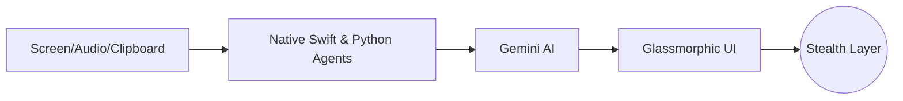

<div align="center">

<h1> 🚀 OpenCluely </h1>
<p><b>The Invisible AI Interview Copilot</b></p>
<p><i>Real-time AI help on a stealth overlay that screen sharing cannot see.</i></p>

<p>
  <a href="https://github.com/TechyCSR/OpenCluely/releases/latest"></a>
  
  
  
</p>

[**Website**](https://opencluely.techycsr.dev) &nbsp;|&nbsp; [**Download**](#-download) &nbsp;|&nbsp; [**Quick Start**](#-quick-start) &nbsp;|&nbsp; [**Features**](#-features)

</div>

---

## 🎥 See It In Action
https://github.com/user-attachments/assets/896a7140-1e85-405d-bfbe-e05c9f3a816b

> [!NOTE]  
> **100% Stealth:** Windows remain completely invisible on Zoom, Google Meet, Teams, Discord, and OBS.

---

## ⚡ Core Features

### 🔍 Native Text Extraction
Instead of slow node-based OCR, we built native extractors:
- **Vision OCR:** Native macOS `VNRecognizeTextRequest` reads any screen text offline instantly.
- **AXUIElement:** Extracts string trees directly from active apps *without* OCR for 100% accuracy.

### 📋 Session Clipboard Manager
- Tracks everything you copy in the background.
- Groups snippets into hourly **Session Blocks**.
- One-click **Copy All** for bulk context pasting.

### 🤖 Human-Simulated Auto-Typer
- Injects LLM answers directly into IDEs.
- Randomized keystroke delays (`15ms` to `65ms`) and line-break pauses bypass anti-cheat paste detection.
- `Escape` hotkey halts typing instantly.

### 🎨 Glassmorphic Minimalism
- Ultra-low opacity rendering that blends into dark wallpapers.
- Quadratic slider binds directly to the root document, allowing elements to fade down to 0.5% visibility.
- 100% SVG-driven iconography with zero high-contrast colors.

### 🧠 Domain-Specific Solvers (MCQ & DSA)
- **MCQ Mode:** Forces Gemini to immediately output the bolded answer (A/B/C/D) followed by a 1-sentence justification. Zero fluff.

---

## 📐 System Architecture



> [!IMPORTANT]
> Every popup, chat box, and command bar is strictly bound to `setContentProtection(true)` and `setVisibleOnAllWorkspaces(true)` to ensure persistent, cross-desktop invisibility.

---

## 🚀 Quick Start

**1. Clone & Setup**
```bash
git clone https://github.com/TechyCSR/OpenCluely.git
cd OpenCluely
./setup.sh
```

**2. Configure API**
Add your free Gemini API key to `.env` or paste it directly in the UI Settings.

---

## 💾 Download

| Platform | Installer | Notes |
|---|---|---|
| **Windows** | [Setup .exe](https://github.com/TechyCSR/OpenCluely/releases/latest) | NSIS installer |
| **Linux** | [.deb](https://github.com/TechyCSR/OpenCluely/releases/latest) | Pulls system deps automatically |
| **macOS** | Run from Source | *macOS Gatekeeper blocks unsigned apps. Run `./setup.sh` directly.* |

---

## ⌨️ Global Shortcuts

| Action | Keybinding |
|---|---|
| **Screenshot Capture** | `Cmd/Ctrl + Shift + S` |
| **Toggle Speech** | `Alt + R` |
| **Hide All Windows** | `Cmd/Ctrl + Shift + V` |
| **Click-Through Mode** | `Alt + A` |
| **Open Chat** | `Cmd/Ctrl + Shift + C` |

<br>
<div align="center">
<i>Built under the MIT License.</i>
</div>
