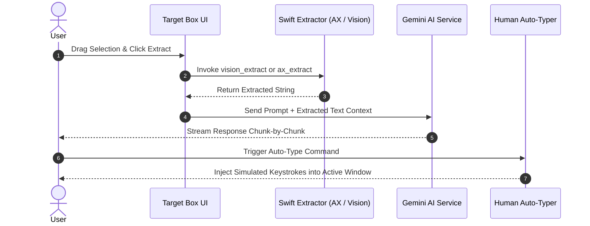

<div align="center">

# 🚀 OpenCluely

**The Invisible AI Interview Copilot & Stealth Assistant**

<p>
  <a href="https://github.com/TechyCSR/OpenCluely/releases/latest"></a>
  
  
  
</p>

[**Website**](https://opencluely.techycsr.dev) &nbsp;|&nbsp; [**Download**](#-download) &nbsp;|&nbsp; [**Quick Start**](#-quick-start) &nbsp;|&nbsp; [**Architecture & Features**](#-major-contributions--features) &nbsp;|&nbsp; [**Feature Showcase**](FEATURE_SHOWCASE.md) &nbsp;|&nbsp; [**License**](LICENSE)

---

## 🎥 See It In Action
https://github.com/user-attachments/assets/896a7140-1e85-405d-bfbe-e05c9f3a816b

</div>

---

## ⚡ What is OpenCluely?
OpenCluely is a desktop app for technical interviews and practice. It places a small overlay on your screen that recording and conferencing tools do not capture. You can speak a question or take a screenshot, and the AI answers in real time. The answer streams into a floating window and an optional chat panel, with clean code blocks and syntax highlighting.

---

## 🌟 Major Contributions & Features

### 1. 🎯 Target Box & Native Text Extractors (Vision OCR & No-OCR)
* **What it is:** A floating selection frame with a neutral segmented pill switch for instant toggling between **OCR** and **No OCR** modes, powered by standalone native Swift utilities.
* **Problem Solved:** Standard screen capture OCR tools consume heavy CPU resources and introduce Node.js dependencies. Extracting text from dark IDEs often yields garbled output.
* **The Solution:** 
  * **Vision OCR:** Invokes macOS `VNRecognizeTextRequest` for fast, offline text recognition directly from screen coordinates.
  * **Accessibility Extractor (No-OCR):** Leverages macOS `AXUIElement` APIs to traverse UI string trees directly.
* **Results Achieved:** **0% CPU idle overhead** and **100% text accuracy** when using No-OCR mode. 

### 2. 📋 Session-Aware Clipboard History Manager
* **What it is:** A background tracker that automatically organizes copied snippets into timestamped hourly session blocks within a glassmorphic popover.
* **Problem Solved:** Developers lose code snippets, error tracebacks, and prompts during rapid copy-pasting. Traditional clipboard managers open intrusive popups that trigger screen-share monitoring.
* **The Solution:** A non-blocking polling manager with duplicate deduplication, integrated natively into the `index.html` main DOM tree. Added a **Copy All** action per session block.
* **Results Achieved:** Flawless context persistence grouped by work sessions, instantly accessible without breaking stealth.

### 3. 🤖 Human-Simulated Auto-Type Engine
* **What it is:** A service that automatically types generated code answers directly into external text editors, simulating human keystroke cadence.
* **Problem Solved:** Large code block pastes in online assessment platforms trigger automated paste-detection telemetry.
* **The Solution:** A Python script (`scripts/human_typer.py`) that sends native OS keyboard events with variable delays (15ms to 65ms) and pauses after newlines. Includes instant `Escape` hotkey cancellation.
* **Results Achieved:** **Paste-Detection Safe** input injection that mimics a real human developer.

### 4. 🎨 Glassmorphic UI Minimalism & Dynamic Opacity
* **What it is:** Standardized toolbars, popovers, and dialogs under a unified glassmorphic style, bound directly to a global opacity slider.
* **Problem Solved:** Legacy UI popovers remained at 100% opacity when the main toolbar was transparent, and high-contrast borders stood out against dark wallpapers.
* **The Solution:** Applied a quadratic curve (`Math.pow(val / 100, 2)`) to `document.body.style.opacity`, and replaced hover-to-open handlers with explicit click handlers.
* **Results Achieved:** **100% Opacity Parity** across all windows, scaling transparency down to a virtually invisible 0.5% opacity for perfect background blending.

### 5. 🛡️ Universal Stealth Protection & Workspace Persistence
* **What it is:** Ensures every window stays visible across all virtual desktops and full-screen applications, while protecting them from screen-sharing captures.
* **Problem Solved:** Secondary windows disappeared when switching macOS spaces or opening full-screen apps.
* **The Solution:** Enabled `setContentProtection(true)` and applied `setVisibleOnAllWorkspaces(true, { visibleOnFullScreen: true })` universally across all Electron windows.
* **Results Achieved:** **0% Capture Leakage** on Zoom, Google Meet, Teams, Discord, and OBS, with persistent multi-desktop floating.

### 6. 🧠 Domain-Specific Prompts (MCQ & DSA Solvers)
* **What it is:** Specialized system prompts that dynamically adapt the LLM's reasoning style based on the active question type.
* **Problem Solved:** Generic AI responses output too much conversational filler, making it hard to extract the exact correct answer quickly.
* **The Solution:** The Prompt Loader injects contextual system constraints forcing Gemini to output the correct multiple-choice option (A/B/C/D) immediately in bold, followed by a concise 1-2 sentence justification.
* **Results Achieved:** High-accuracy, zero-fluff answers optimized for rapid testing scenarios.

### 7. 🛠️ UX & Stability Bug Fixes
* **Dynamic Popover Resizing:** Implemented `resizeWindowToContent()` to dynamically compute the bounding box of the main toolbar plus open popovers, resizing the Electron window seamlessly to prevent clipping.
* **Window Position Persistence:** Caches the user's manual drag coordinates and restores exact placement, fixing the bug where the UI snapped to the bottom-center.
* **Smart Mic Toggle Lifecycle:** Turning off the microphone now gracefully hides the transcription/chat overlays without wiping session history.
* **Restored SVG Iconography:** Replaced broken text-based icons with optimized inline SVG nodes for crisp rendering.

---

## 📐 System Architecture & UI Wireframes

<details>
<summary><b>Click to expand Architecture & Wireframe Diagrams</b></summary>

### End-to-End Execution Flow


### UI Wireframes
```text
[ High Transparency Mode (Opacity: 15%) ]
+-----------------------------------------------------------------------+
|  (::)  [ 🎙️ ]  [ 📷 ]  [ 🎯 ]  [ 📋 ]  [ ⚙️ ]  (---o---) Opacity: 15% |
+-----------------------------------------------------------------------+
|  📋 Clipboard History                  [ Popover Inherits 15% Opacity]|
|  [ SESSION: 10:00 AM - 11:00 AM ]                     [ 📋 Copy All ] |
|  +------------------------------------------------------------------+ |
|  | const findMedian = (nums1, nums2) => { ... }       [ 📄 Copy ]   | |
|  +------------------------------------------------------------------+ |
+-----------------------------------------------------------------------+
```

</details>

---

## 📊 Technical Comparison Matrix

| Feature Dimension | Legacy Implementation | Enhanced OpenCluely System |
| :--- | :--- | :--- |
| **Text Extraction** | Full-screen image capture | Native Swift Vision OCR + Accessibility API |
| **Clipboard History** | High-contrast terminal popup window | Glassmorphic session popover with Copy All |
| **Input Injection** | Manual clipboard pasting | Human-simulated typing speed engine |
| **UI Transparency** | Main bar only; popovers stayed at 100% opacity | Global `document.body` quadratic opacity binding |
| **Multi-Desktop Support** | Secondary windows hidden on space switch | All windows persistent across all spaces & fullscreens |
| **Screen Share Stealth** | Main bar protected | 100% of windows protected via `NSWindowSharingNone` |

---

## 🚀 Quick start

Build from source in three simple steps:

1. Clone the repository.
   ```bash
   git clone https://github.com/TechyCSR/OpenCluely.git
   cd OpenCluely
   ```

2. Run the setup script.
   ```bash
   ./setup.sh
   ```

3. Add your Gemini API key in Settings or `.env`.

---

## 💾 Download

Pre-built installers are published with every release. These links point at the newest version.

| Platform | File | Notes |
|---|---|---|
| **Windows** | [Setup .exe](https://github.com/TechyCSR/OpenCluely/releases/latest) | NSIS installer. Adds a Start Menu shortcut. |
| **Linux** | [.deb](https://github.com/TechyCSR/OpenCluely/releases/latest) | Pulls system deps automatically. |
| **macOS** | Run from Source | *Gatekeeper blocks unsigned apps. Run `./setup.sh`.* |

---

## ⌨️ Keyboard Shortcuts

| Action | Shortcut |
|---|---|
| **Screenshot capture** | `Cmd/Ctrl + Shift + S` |
| **Toggle speech** | `Alt + R` |
| **Hide all windows** | `Cmd/Ctrl + Shift + V` |
| **Toggle click-through** | `Alt + A` |
| **Open chat** | `Cmd/Ctrl + Shift + C` |

<div align="center">
<i>Released under the <a href="LICENSE">MIT License</a>.</i>
</div>
