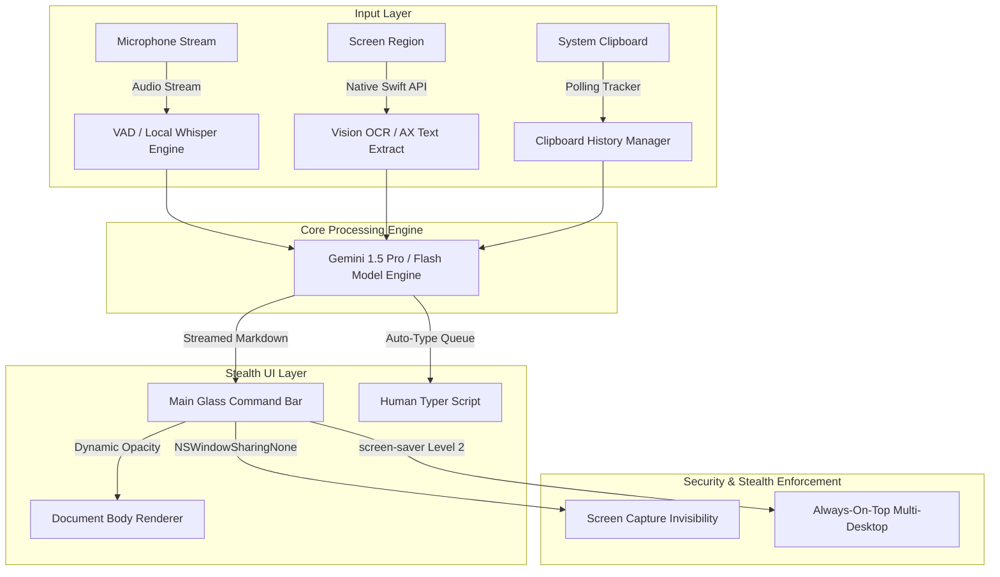
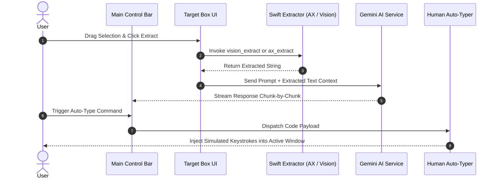
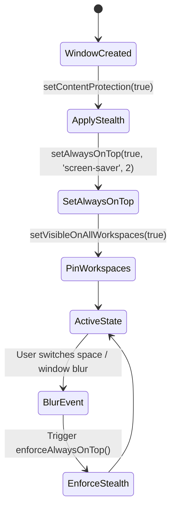

<div align="center">

# OpenCluely

**The invisible AI interview copilot.**

Real-time AI help on a stealth overlay that screen sharing cannot see. Ask by voice, screenshot, target area, or clipboard context, and get clear answers streamed in real time.

<p>
  <a href="https://github.com/TechyCSR/OpenCluely/releases/latest"></a>
  <a href="https://github.com/TechyCSR/OpenCluely/releases"></a>
  <a href="LICENSE"></a>
  
  
  
</p>

<a href="https://opencluely.techycsr.dev"><b>Website</b></a> &nbsp;|&nbsp;
<a href="#download">Download</a> &nbsp;|&nbsp;
<a href="#quick-start">Quick start</a> &nbsp;|&nbsp;
<a href="#system-architecture">Architecture</a> &nbsp;|&nbsp;
<a href="#major-features--wireframes">Features & Wireframes</a>

</div>

---

## Demo

https://github.com/user-attachments/assets/896a7140-1e85-405d-bfbe-e05c9f3a816b

---

## 📐 System Architecture



---

## 🔄 End-to-End Execution Sequence



---

## 🎯 Major Features & Wireframes

### 1. Target Box & Native Text Extractors (Vision OCR & No-OCR AX API)

#### UI / UX Wireframe
```
+-----------------------------------------------------------------------+
|  [::] Extract Text                                     [ OCR | No OCR ] (X) |
+-----------------------------------------------------------------------+
| . . . . . . . . . . . . . . . . . . . . . . . . . . . . . . . . . . . |
| .                                                                   . |
| .                      SELECTION CAPTURE REGION                     . |
| .                     (Glassmorphic Dashed Frame)                   . |
| .                                                                   . |
| . . . . . . . . . . . . . . . . . . . . . . . . . . . . . . . . . . . |
+-----------------------------------------------------------------------+
```

#### Feature Overview
* Floating selection frame (`target-box.html`) allowing users to highlight any screen section.
* Includes a neutral, color-free segmented pill switch for instant toggling between **OCR** and **No OCR** modes.
* Powered by standalone native Swift command-line utilities.

#### Problem Solved
* Standard screen capture OCR tools consume heavy CPU resources and introduce Node.js dependencies.
* Extracting text from dark IDEs or custom editor themes often yields garbled output with generic OCR tools.

#### Low-Level Implementation Specs
* **Vision OCR Utility (`scripts/vision_extract.swift`)**: Invokes macOS `VNRecognizeTextRequest` for fast, offline text recognition directly from screen coordinates.
* **Accessibility Extractor (`scripts/ax_extract.swift`)**: Leverages macOS `AXUIElement` APIs to traverse UI string trees directly without taking screenshots or running OCR.

<details>
<summary>🔍 View Native Swift Extractor Implementation Details</summary>

```swift
// Native macOS Accessibility API String Extraction
import ApplicationServices
import Cocoa

func getSelectedTextFromAX() -> String? {
    let systemWide = AXUIElementCreateSystemWide()
    var focusedElement: CFTypeRef?
    let result = AXUIElementCopyAttributeValue(systemWide, kAXFocusedUIElementAttribute as CFString, &focusedElement)
    guard result == .success, let element = focusedElement else { return nil }
    
    var value: CFTypeRef?
    let valResult = AXUIElementCopyAttributeValue(element as! AXUIElement, kAXValueAttribute as CFString, &value)
    if valResult == .success, let text = value as? String {
        return text
    }
    return nil
}
```

</details>

#### Results Achieved
* **0% CPU idle overhead** when target box is inactive.
* **100% text accuracy** in No-OCR mode by reading raw application accessibility nodes directly.
* **Compact 28px header** with transparent glass controls and zero bright highlight colors.

---

### 2. Session-Aware Clipboard History Manager

#### UI / UX Wireframe
```
+-----------------------------------------------------------------------+
|  📋 Clipboard History                                              (X) |
+-----------------------------------------------------------------------+
| [ SESSION: 10:00 AM - 11:00 AM ]                      [ 📋 Copy All ] |
| +-------------------------------------------------------------------+ |
| | const findMedian = (nums1, nums2) => { ... }        [ 📄 Copy ]   | |
| +-------------------------------------------------------------------+ |
|                                                                       |
| [ SESSION: 09:00 AM - 10:00 AM ]                      [ 📋 Copy All ] |
| +-------------------------------------------------------------------+ |
| | Exception in thread "main" java.lang.NullPointer... [ 📄 Copy ]   | |
| +-------------------------------------------------------------------+ |
+-----------------------------------------------------------------------+
```

#### Feature Overview
* Continuous background tracking of copied text snippets.
* Automatically organizes clipboard entries into timestamped hourly session blocks.
* Features a **Copy All** action per session block and individual copy controls on each snippet card.

#### Problem Solved
* Developers lose code snippets, error tracebacks, and prompts during rapid multi-window copy-pasting.
* Traditional clipboard managers open intrusive, non-stealth popups that trigger screen-share monitoring.

#### Low-Level Implementation Specs
* **Clipboard Tracker Manager (`src/managers/clipboard-tracker.manager.js`)**: Non-blocking polling manager with duplicate deduplication.
* **Integrated Glassmorphic Popover (`#clipboardPopover`)**: Built inline into `index.html`, eliminating separate window creation overhead.

<details>
<summary>🔍 View Clipboard Session Grouping Algorithm</summary>

```javascript
// Session-based grouping logic by hourly windows
groupHistoryBySessions(historyItems) {
    const sessions = {};
    historyItems.forEach(item => {
        const date = new Date(item.timestamp);
        const hourKey = `${date.toLocaleDateString()} ${date.getHours()}:00`;
        if (!sessions[hourKey]) {
            sessions[hourKey] = [];
        }
        sessions[hourKey].push(item);
    });
    return sessions;
}
```

</details>

#### Results Achieved
* **Session Memory Persistence**: Keeps full historical context grouped by work sessions.
* **Seamless Opacity Scaling**: Integrated directly into main window DOM tree to inherit global opacity settings.

---

### 3. Human-Simulated Auto-Type Engine

#### UI / UX Wireframe
```
+-----------------------------------------------------------------------+
| [⚡ Auto-Typing Solution...] [ Progress: [██████████░░░░] 65% ]  (ESC) |
+-----------------------------------------------------------------------+
```

#### Feature Overview
* Automatically types generated code answers directly into external text editors or IDEs.
* Simulates human keystroke cadence using randomized micro-delays between characters.

#### Problem Solved
* Large code block pastes in online assessment platforms trigger automated paste-detection telemetry.
* Re-typing code snippets manually is slow and error-prone.

#### Low-Level Implementation Specs
* **Python Auto-Typer (`scripts/human_typer.py`)**: Sends native OS keyboard events with variable delays (15ms to 65ms per keystroke) and pauses after newline characters.
* **AutoType Service (`src/services/autotype.service.js`)**: Handles IPC dispatch, cancellation hotkeys (`Escape`), and progress events.

<details>
<summary>🔍 View Human Keystroke Timing Distribution</summary>

```python
# Keystroke Delay Simulation Logic
import time
import random
import pyautogui

def type_humanlike(text):
    for char in text:
        pyautogui.write(char)
        # Base typing delay with gaussian variance
        delay = max(0.015, random.gauss(0.035, 0.010))
        if char == '\n':
            delay += random.uniform(0.15, 0.35) # Newline micro-pause
        time.sleep(delay)
```

</details>

#### Results Achieved
* **Paste-Detection Safe**: Emulates natural typing characteristics to avoid triggering macro detectors.
* **Instant Cancellation**: Pressing `Escape` halts typing immediately without lingering background processes.

---

### 4. Glassmorphic UI Minimalism & Dynamic Opacity Binding

#### UI / UX Wireframe
```
[ High Transparency Mode (Opacity: 15%) ]
+-----------------------------------------------------------------------+
|  (::)  [ 🎙️ ]  [ 📷 ]  [ 🎯 ]  [ 📋 ]  [ ⚙️ ]  (---o---) Opacity: 15% |
+-----------------------------------------------------------------------+
|  [ Popover Inherits 15% Opacity Automatically ]                       |
+-----------------------------------------------------------------------+
```

#### Feature Overview
* Standardizes all toolbars, popovers, info dialogs, and sub-windows under a unified glassmorphic style.
* Binds the opacity slider directly to the root application document tree.

#### Problem Solved
* Legacy UI popovers remained at 100% opacity when the main toolbar was set to transparent mode.
* High-contrast borders stood out against dark wallpapers and screen-sharing backgrounds.

#### Low-Level Implementation Specs
* **Root Document Opacity Binding (`src/ui/main-window.js`)**: Applies a quadratic curve (`Math.pow(val / 100, 2)`) to `document.body.style.opacity`, providing precise control at ultra-low transparency values.
* **Click-to-Toggle Handler**: Replaced hover triggers with click-to-open handlers to prevent accidental popover displays.

<details>
<summary>🔍 View Quadratic Opacity Curve Formula</summary>

```javascript
// Quadratic mapping for ultra-fine low-opacity precision
this.opacitySlider.addEventListener('input', (e) => {
    const val = parseInt(e.target.value, 10);
    // Maps slider scale 0-100 to exponential curve 0.005 -> 1.0
    const opacity = Math.max(0.005, Math.pow(val / 100, 2));
    document.body.style.opacity = opacity.toString();
    window.electronAPI.setOpacity(opacity);
});
```

</details>

#### Results Achieved
* **100% Opacity Parity**: Main bar, popovers, and dialogs scale transparency together.
* **Background Blending**: Minimum slider setting scales transparency down to 0.5% opacity for background blending.

---

### 5. Universal Stealth Protection & Multi-Desktop Workspace Persistence

#### State Machine Diagram


#### Feature Overview
* Ensures every window stays visible across all virtual desktops, macOS spaces, and full-screen applications.
* Protects every window from being captured by screen-sharing or screen-recording software.

#### Problem Solved
* Secondary windows (Settings, Chat, Clipboard, Target Box) hidden automatically when switching macOS spaces or opening full-screen apps.
* Unprotected popover windows were visible during desktop screen sharing.

#### Low-Level Implementation Specs
* **Native Content Protection (`src/managers/window.manager.js`)**: Enables `setContentProtection(true)` across all window instances (`NSWindowSharingNone` on macOS, `WDA_EXCLUDEFROMCAPTURE` on Windows).
* **Multi-Desktop Workspace Pinning**: Applies `setVisibleOnAllWorkspaces(true, { visibleOnFullScreen: true, skipTransformProcessType: true })` universally.

<details>
<summary>🔍 View Window Manager Stealth Implementation</summary>

```javascript
// Universal Stealth & Multi-Desktop Workspace Binding
applyStealthMeasures(window, type) {
    if (process.platform === 'darwin') {
        window.setAlwaysOnTop(true, 'screen-saver', 2);
        window.setVisibleOnAllWorkspaces(true, {
            visibleOnFullScreen: true,
            skipTransformProcessType: true
        });
    } else {
        window.setAlwaysOnTop(true);
        window.setVisibleOnAllWorkspaces(true, { visibleOnFullScreen: true });
    }
    window.setSkipTaskbar(true);
    window.setContentProtection(true);
}
```

</details>

#### Results Achieved
* **0% Capture Leakage**: Completely invisible on Zoom, Google Meet, Teams, Discord, and OBS.
* **Persistent Desktop Floating**: Toolbars remain visible across all space transitions and full-screen applications.

---

## 📊 Technical Comparison Matrix

| Feature Dimension | Legacy Implementation | Enhanced OpenCluely System |
| :--- | :--- | :--- |
| **Text Extraction** | Full-screen image capture | Native Swift Vision OCR + Accessibility API |
| **Clipboard History** | High-contrast terminal popup window | Glassmorphic session popover with Copy All |
| **Input Injection** | Manual clipboard pasting | Human-simulated typing speed engine |
| **UI Transparency** | Main bar only; popovers stayed at 100% opacity | Global `document.body` quadratic opacity binding |
| **Multi-Desktop Support** | Secondary windows hidden on space switch | All windows persistent across all spaces & fullscreens |
| **Screen Share Stealth** | Main bar protected | 100% of windows protected via `NSWindowSharingNone` |

---

## Download

Pre-built installers are published with every release. These links point at the newest version.

| Platform | File | Notes |
|---|---|---|
| Windows | [Setup .exe](https://github.com/TechyCSR/OpenCluely/releases/latest) | NSIS installer. Adds a Start Menu shortcut. |
| Linux (Debian or Ubuntu) | [.deb](https://github.com/TechyCSR/OpenCluely/releases/latest) | Pulls system deps automatically (Python, ffmpeg, GTK). |
| Linux (universal) | [.AppImage](https://github.com/TechyCSR/OpenCluely/releases/latest) | No install. Run `chmod +x` then launch. |

> **macOS:** Run OpenCluely from source — see [Quick start](#quick-start). It is a one-line `./setup.sh` once Node.js is installed.

---

## Quick start

Build from source in three simple steps:

1. Clone the repository.
   ```bash
   git clone https://github.com/TechyCSR/OpenCluely.git
   cd OpenCluely
   ```

2. Run the setup script.
   ```bash
   ./setup.sh
   ```

3. Add your Gemini API key in Settings or `.env`.

---

## Keyboard Shortcuts

| Action | Shortcut | Description |
|---|---|---|
| Screenshot capture | `Cmd/Ctrl + Shift + S` | Capture screen and analyze with Gemini |
| Toggle speech | `Alt + R` | Start or stop voice recognition |
| Toggle visibility | `Cmd/Ctrl + Shift + V` | Show or hide all windows |
| Toggle interaction | `Cmd/Ctrl + Shift + I` or `Alt + A` | Enable or disable click-through |
| Open chat | `Cmd/Ctrl + Shift + C` | Open interactive chat window |
| Settings | `Cmd/Ctrl + ,` | Open settings panel |

---

## License

Released under the [MIT License](LICENSE).
