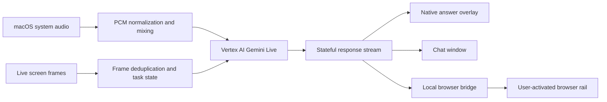

<div align="center">

# OpenCluely — Gemini Live Fork

**A stateful, real-time screen and conversation copilot for practice and AI-permitted calls.**

[What changed](#what-this-fork-changes) · [Quick start](#quick-start) · [Controls](#controls) · [Browser rail](#browser-rail) · [Upstream](https://github.com/TechyCSR/OpenCluely)

</div>

> This fork explores a Gemini Live-first architecture on macOS. It is based on [TechyCSR/OpenCluely](https://github.com/TechyCSR/OpenCluely) and retains its Apache 2.0 license and attribution.

## What this fork changes

The original app is centered on one-shot screenshots and optional speech providers. This fork adds a persistent assistance loop that combines changing screen context with live conversation while preserving the user's active objective.

- **Gemini Live audio.** Streams macOS system audio to Vertex AI Gemini Live for low-latency transcription and responses.
- **Stateful screen understanding.** Samples the active screen continuously, suppresses duplicate frames, and maintains an active-task anchor.
- **Intent-aware assistance.** Short conversational detours do not erase the current coding problem, document, or unfinished step.
- **Useful technical structure.** Coding responses prioritize intent, approach, correctness, walkthrough, code, complexity, and edge cases.
- **Multiple response surfaces.** Results can appear in the native answer overlay, chat window, or an explicitly activated browser rail.
- **Focus-safe macOS overlays.** Operational overlay windows avoid activating the app or pulling focus away from the current application.
- **Reduced local load.** The packaged runtime no longer ships the legacy Whisper worker, models, or heavy speech dependencies.
- **No API-key fallback.** The Gemini path uses Vertex AI with local Google Application Default Credentials.

## Architecture



The browser bridge binds only to `127.0.0.1`. It accepts Chrome-extension origins and a small allowlist of commands and response channels. Ordinary webpages cannot connect directly.

## Requirements

The new live-audio path is currently macOS-focused.

- macOS with Screen Recording permission
- Node.js 18 or newer
- Google Cloud CLI (`gcloud`)
- A billed Google Cloud project with Vertex AI enabled
- `ffmpeg` available on `PATH`
- Chrome only if you want the optional browser rail

## Quick start

1. Clone this fork.

   ```bash
   git clone https://github.com/0xtigerclaw/OpenCluely.git
   cd OpenCluely
   ```

2. Install dependencies and create the local environment file.

   ```bash
   ./setup.sh --no-run
   ```

3. Authenticate the Google account that has access to your Vertex AI project.

   ```bash
   gcloud auth application-default login
   ```

4. Add your project to `.env`.

   ```bash
   GOOGLE_CLOUD_PROJECT=your-billed-gcp-project
   GOOGLE_CLOUD_LOCATION=europe-west4
   GEMINI_LIVE_MODEL=gemini-live-2.5-flash-native-audio
   FFMPEG_COMMAND=ffmpeg
   ```

5. Start the app.

   ```bash
   npm start
   ```

On first use, grant Screen Recording permission under **System Settings → Privacy & Security → Screen & System Audio Recording** and relaunch OpenCluely.

## Google Cloud setup

Your project must have billing and Vertex AI access. If you have permission to enable services:

```bash
gcloud services enable aiplatform.googleapis.com --project your-billed-gcp-project
```

Application Default Credentials remain in your normal local Google Cloud configuration. They are never committed to this repository. To switch accounts, rerun `gcloud auth application-default login` and select the intended account.

## Controls

| Action | macOS shortcut | Purpose |
| --- | --- | --- |
| Toggle Live Screen | `Cmd + Shift + G` | Continuously analyze meaningful screen changes |
| Toggle Call Copilot | `Cmd + Shift + L` | Start or stop system-audio streaming to Gemini Live |
| Analyze one screenshot | `Cmd + Shift + S` | Force a fresh one-shot screen analysis |
| Open chat | `Cmd + Shift + C` | Ask a typed follow-up with session context |
| Bring windows forward | `Cmd + Shift + V` | Show OpenCluely windows on the current desktop |
| Toggle interaction | `Cmd + Shift + I` or `Option + A` | Enable or disable clicks on native overlays |
| Clear task memory | `Cmd + Shift + \` | Start a clean task or conversation |
| Open settings | `Cmd + ,` | Configure the app |
| Force always-on-top | `Cmd + Shift + T` | Restore overlay window level |

Use the **Exit App** button in the UI or the application menu to stop capture and close all processes cleanly.

## Browser rail

The optional Chrome extension displays OpenCluely responses inside only the tab you explicitly activate.

1. Open `chrome://extensions`.
2. Enable **Developer mode**.
3. Choose **Load unpacked**.
4. Select this repository's `browser-extension` directory.
5. Pin **OpenCluely Browser Rail** from Chrome's extensions menu.
6. On the page where you want the rail, click its toolbar icon.

The extension uses `activeTab` and `scripting`; it does not request persistent access to every website. Activate it again after navigating to a new page.

> The browser rail is rendered inside the webpage. It is visible in tab, window, and full-screen sharing. Use the native overlay or a separate unshared display when the rail should not be included in a permitted screen share.

## How state is handled

OpenCluely keeps one active-task anchor and treats brief unrelated conversation as a temporary detour. For example, a social question during a coding exercise can receive a short answer without discarding the problem statement, current approach, code, or unfinished step. An explicit task switch—or sustained work on a new task—replaces the anchor.

Screen frames refine that state instead of creating a new conversation on every capture. Duplicate or low-information frames are skipped to reduce cost, latency, and answer churn.

## Configuration

The main environment values are documented in [`env.example`](env.example):

| Variable | Purpose |
| --- | --- |
| `GOOGLE_CLOUD_PROJECT` | Billed project used for Vertex AI |
| `GOOGLE_CLOUD_LOCATION` | Vertex AI region; defaults to `europe-west4` |
| `GEMINI_LIVE_MODEL` | Gemini Live model resource name |
| `SYSTEM_AUDIO_COMMAND` | Optional explicit path to `SystemAudioDump` |
| `FFMPEG_COMMAND` | `ffmpeg` command or absolute path |
| `CALL_COPILOT_SILENCE_MS` | Pause duration that closes a natural utterance |
| `CALL_COPILOT_MAX_UTTERANCE_MS` | Maximum continuous utterance duration |
| `CALL_COPILOT_VAD_FLOOR` | Minimum voice-activity energy floor |

## Build

```bash
npm run build:mac
```

The build produces Intel and Apple Silicon DMG and ZIP artifacts under `dist/`. Local builds may use an installed Apple signing identity automatically. This repository does not contain signing or notarization credentials.

## Privacy, permissions, and responsible use

- OpenCluely starts Live Screen and Call Copilot only after an explicit user action.
- Screen and audio context is sent to the configured Google Cloud Vertex AI project when those features are active.
- The app writes local diagnostic logs but does not add a telemetry service.
- The native Electron overlay and the browser rail have different capture behavior; the browser rail is not private from screen sharing.
- Record or process a conversation only with appropriate consent and where recording and AI assistance are allowed.
- Use the project for learning, accessibility, personal productivity, and disclosed assistance—not to violate interview, assessment, workplace, or platform rules.

## Current limitations

- Gemini Live system-audio capture is currently implemented for macOS.
- The browser rail must be reactivated after navigation.
- Builds are not notarized by this fork.
- Screen-capture exclusion depends on the operating system and capture software and should not be treated as a security boundary.
- Gemini Live model availability, quotas, and regions depend on your Google Cloud account.

## Validation performed

- JavaScript, shell, JSON, and whitespace checks
- Browser bridge test: extension origin accepted, webpage origin rejected
- Credential and machine-specific identifier scan
- Packaged ASAR inspection confirming legacy Whisper runtime and local coaching artifacts are excluded
- Successful macOS x64 and arm64 DMG/ZIP builds

## Upstream and license

This project is a fork of [TechyCSR/OpenCluely](https://github.com/TechyCSR/OpenCluely). The upstream project, its authors, and prior contributors remain credited in Git history. New fork-specific work is proposed upstream separately where appropriate.

Released under the [Apache License 2.0](LICENSE).
